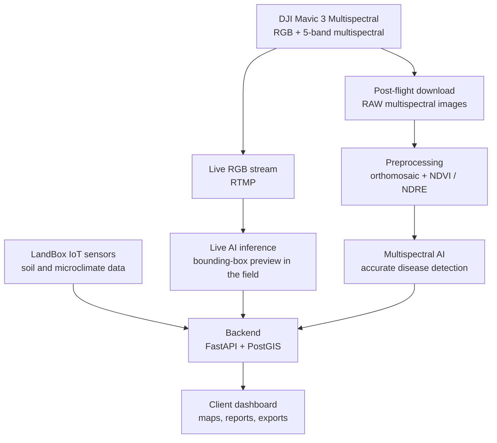

# KestrelEye (Sagacè)

**Precision viticulture powered by AI and drone imaging.**

KestrelEye is an ongoing project to build a data-driven diagnostic service for vineyards. It combines multispectral drone surveys, in-field IoT sensors and computer vision into a single service for wineries and agronomists, producing georeferenced maps and agronomic reports on vine vigour, water stress and plant diseases.

The project focuses first on DOC/DOCG viticulture in Friuli-Venezia Giulia (Italy), with models trained on local grape varieties such as Friulano, Ribolla Gialla, Refosco and Merlot.

> **Status:** early development. The first component, the vine detection and disease classification models, is implemented. The rest of the system described below is under active design and development.

---

## Why

Pests and plant diseases destroy up to 40% of global crop production every year. The problem is often less the pathogen itself than a late, field-wide response: entire plots are treated after symptoms are visible, wasting product, water, fuel and money.

KestrelEye aims to detect stress and disease outbreaks before they are visible to the naked eye and show exactly where to intervene, reducing chemical and water inputs while protecting yield.

| Component | Model | Purpose |
|---|---|---|
| Vine detection | **YOLO** | Locates vines in drone imagery |
| Disease classification | **ResNet50** | Classifies the health condition / disease of each detected vine |

These two models form the core of the AI pipeline: YOLO isolates the plants, and ResNet50 classifies the detected crops into disease classes.

## Planned architecture

The full system is being developed as a modular pipeline, where each component can be updated or replaced independently.

### Hybrid live + post-flight approach

- **Live (RGB):** while the drone flies, RGB frames are analysed in real time to give operators a quick field preview and support immediate decisions.
- **Post-flight (multispectral):** after landing, multispectral images are processed into orthomosaics and vegetation indices (NDVI, NDRE, GNDVI, OSAVI) for accurate, reportable analysis. This is the official result.

Live multispectral streaming is not supported by the drone hardware, so the precise analysis happens after the flight by design.

### Key technical features (in development)

- **Canopy isolation via CHM masking (DSM − DTM):** separates the vine canopy from the grass cover in alternating inter-rows, so indices are computed on the vines only.
- **Target diseases:** downy mildew (*Peronospora*), powdery mildew (*Oidio*), grey mould (*Botrytis*) and *Flavescence dorée*.
- **Model outputs:** geolocated detections with confidence score and estimated severity.
- **LLM support:** user-friendly descriptions of the findings for the end client.

---

## Components

### Drone — DJI Mavic 3 Multispectral
- 20 MP RGB camera for live preview
- Multispectral sensor (Green, Red, Red Edge, NIR) for post-flight analysis
- RTK positioning (1–2 cm) for accurate georeferencing
- About 25 ha covered per flight with 80% overlap

### LandBox — in-house IoT ground stations
A network of in-field sensors developed in-house, providing soil and microclimate ground truth to correlate with aerial data.
- **Parent node:** Raspberry Pi 4 with LoRa gateway (aggregation and cloud upload)
- **Child nodes:** ESP32 / Raspberry Pi Zero 2W with local sensors
- **Sensors:** temperature, humidity, soil moisture, light
- **Power and enclosure:** solar + LiFePO4 battery, 3D-printed ASA enclosure (IP68)

LandBox is being field-tested at a pilot vineyard, with LoRa communication currently being integrated.

### Software stack

| Layer | Technology |
|---|---|
| Live AI (RGB) | YOLO, Python, OpenCV |
| Post-flight preprocessing | Pix4Dfields (OpenDroneMap as a future open-source alternative) |
| Multispectral AI | Python, rasterio, NumPy, scikit-learn, CNN models |
| Backend | FastAPI, PostGIS (SpatiaLite for the MVP), REST + WebSocket |
| Frontend | Leaflet.js dashboard with live overlays |
| Export | ReportLab, rasterio, GeoJSON |
| Deployment | Docker Compose |

---

## Planned outputs

- **Interactive dashboard:** map overlays, filters by date, row, anomaly type and vegetation index, and comparison across past flights
- **PDF reports:** anomaly heatmaps, vegetation indices, detection table with GPS coordinates, type, confidence and severity, change since the previous flight, and agronomic recommendations
- **GIS exports:** GeoTIFF, GeoJSON, Shapefile, georeferenced PNG

---

## Team

- **Davide Borsi** — drone and robotic systems engineering (hardware, electronics, flight operations)
- **Lucas Lorenzo Jakin** — computer engineering (computer vision, ML pipelines, software development)

Based in Gorizia, Friuli-Venezia Giulia, Italy.
